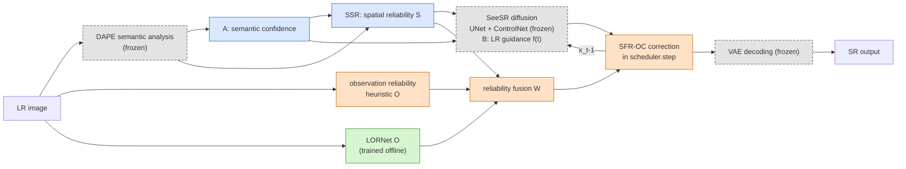
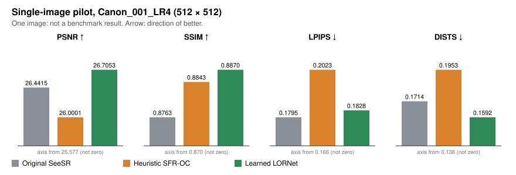
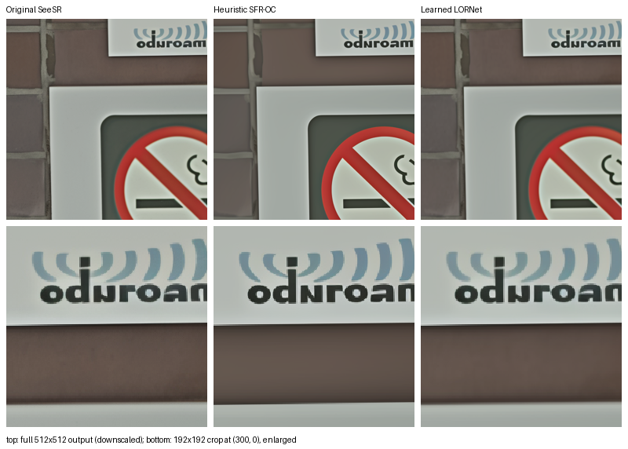

# CFA-SeeSR: Confidence and Fidelity-Aware SeeSR

CFA-SeeSR is a research extension of [SeeSR](https://github.com/cswry/SeeSR) (Wu et al., CVPR 2024) for real-world
image super-resolution. SeeSR steers a Stable Diffusion 2 ControlNet with semantic prompts that its degradation-aware
prompt extractor (DAPE) reads from the low-resolution (LR) image. Two kinds of unreliability remain:

* **semantic**: DAPE's tags and their image attention can be wrong or uncertain, yet they condition every step;
* **fidelity**: the diffusion prior can invent high-frequency detail and drift from the low-frequency content that
  the LR observation actually supports.

CFA-SeeSR adds reliability estimates at inference time and uses them to modulate the conditioning (V1) and to pull
the denoising trajectory toward the LR observation in the low frequencies, where and when the observation is
trustworthy (V2.1). The SeeSR backbone (UNet, ControlNet, DAPE, VAE) is used **unchanged and frozen**; every
component is attached by hooks, off by default, and recorded in each run's metadata.

> **Status.** The implementation is complete and unit-tested on CPU. GPU evidence so far is a **single-image pilot**
> (below). Dataset-level evaluation on RealSR / DRealSR has not been run; no benchmark improvement is claimed.

## Contributions

| # | Component | What it does | Code |
|---|---|---|---|
| 1 | **Semantic confidence** (A) | Per-tag confidence from DAPE's logits and thresholds; drops low-confidence tags and scales the soft (embedding) prompt by an image-level reliability C | `cfa_seesr/semantic_confidence.py` |
| 2 | **Timestep-dependent LR guidance** (B) | Scales ControlNet's LR residuals with a schedule f(t) over the actual DDPM timestep | `cfa_seesr/lr_guidance.py` |
| 3 | **Spatial Semantic Reliability** (SSR) | Turns DAPE's tag-to-patch attention into a spatial map that modulates the soft prompt per location | `cfa_seesr/spatial_reliability.py` |
| 4 | **SFR-OC** — Semantic- and Fidelity-Reliability guided, Frequency-selective Observation Consistency | In each scheduler step, moves the low-frequency part of the predicted clean latent toward the LR latent, weighted by a reliability map W and a timestep schedule; no extra UNet/ControlNet pass | `cfa_seesr/observation_consistency.py`, `frequency.py` |
| 5 | **LORNet** — Learned Observation Reliability Network | 33,049-parameter CNN that predicts where the LR observation agrees with the HR image in the VAE latent space; trained offline, backbone frozen | `cfa_seesr/lornet.py`, `experiments/training/` |

SFR-OC's map can come from two pathways:

* **heuristic** (training-free): noise-compensated local indicators of the LR image — edge coherence, band energy,
  contrast, signal share, sharpness (`cfa_seesr/observation_reliability.py`);
* **learned**: LORNet, supervised by the agreement of LR and HR latents of the frozen VAE on paired training data.

Both are fused with semantic reliability: W = clip(w_obs·O + w_sem·(1 − S)), S from SSR (or component A).

## Architecture



Grey dashed: frozen pretrained SeeSR networks; blue: V1; orange: V2.1 inference code; green: the only trained part.
Detailed diagrams (V1, V2.1 inference, LORNet network, LORNet training, SFR-OC data flow and timestep placement):
[`docs/ARCHITECTURE.md`](docs/ARCHITECTURE.md).

## Method in brief

Full derivations: [`docs/methodology.md`](docs/methodology.md) and [`cfa_seesr/README.md`](cfa_seesr/README.md).

**SFR-OC correction.** At a reverse step with predicted clean latent x̂₀ and reference z_lr (posterior mean of the VAE
encoding of the upscaled LR image):

```
Δ        = γ(t) · LPF_h( W ⊙ LPF_h(z_lr − x̂₀) )          two-pass Gaussian low-pass (σ = 3 latent px overall)
x_{t−1}' = scheduler.step(model_output, t, x_t) + c₀(t) · Δ
```

c₀(t) is the coefficient of x̂₀ in the DDPM / DDIM update, so this equals stepping with x̂₀ + Δ (tested in float64)
while the step itself runs on the original model output (same dtype, same noise draw). γ(t) = strength·t/T; with
strength 0 the step is untouched, bit for bit. The second low-pass removes the high frequencies that multiplication
by a spatial map W would otherwise introduce. The Gaussian is not band-limited: it halves amplitudes at a period of
about 16 latent px (≈ 128 output px).

**LORNet.** Input: luminance, gradient magnitude, local contrast, high-frequency energy of the conditioning image.
Depthwise-separable encoder to 1/16 resolution with a multi-dilation context block, decoder with a skip at 1/8,
sigmoid map at latent resolution (1/8). Target: R = exp(−E/τ), E = local average of |LPF(z_lr − z_hr)| from the
frozen VAE; loss: Charbonnier + 0.05·TV. Only LORNet is trained.

## LORNet training (pilot checkpoint `lornet_v1`)

| | |
|---|---|
| Trainable parameters | 33,049 (LORNet only; SeeSR UNet, ControlNet, DAPE and VAE frozen) |
| Architecture | depthwise-separable multi-scale CNN, 4 input features, sigmoid output at 1/8 resolution |
| Data | RealSR V3 Canon + Nikon **training** split: 400 pairs → 368 training / 32 validation images (hash split by image) |
| Latent cache | 1,088 training / 101 validation crops (512 px HR, frozen-VAE latents); τ = 0.32633 |
| Objective | Charbonnier(σ(logit), exp(−E/τ)) + 0.05 · TV; AdamW 2e-3, cosine schedule |
| Selection | early stopping at epoch 11 (patience 8); best checkpoint: epoch 3, validation loss 0.111512 |
| Hardware | Colab Tesla T4, ≈ 14 s per epoch |

Config: [`experiments/training/configs/lornet_realsr_v3.yaml`](experiments/training/configs/lornet_realsr_v3.yaml);
log and summary: [`assets/training/`](assets/training/). The checkpoint itself is not in the repository.

## Pilot results (single image)

Observed GPU pilot on **Canon_001_LR4**, a StableSR RealSR test crop (byte-identical to the test file, SHA-256
verified), 128 → 512, DDPM 30 steps, CFG 5.5, seed 42, Tesla T4, SFR-OC strength 1.0. Paired metrics from
`experiments/evaluation/evaluate.py` (PSNR/SSIM on Y); every CSV, metadata file and SR output is in
[`assets/pilots/canon_001/`](assets/pilots/canon_001/).

| Metric | Original SeeSR | Heuristic SFR-OC | Learned LORNet |
|---|---:|---:|---:|
| PSNR ↑ | 26.4415 | 26.0001 | **26.7053** |
| SSIM ↑ | 0.8763 | 0.8843 | **0.8870** |
| LPIPS ↓ | **0.1795** | 0.2023 | 0.1828 |
| DISTS ↓ | 0.1714 | 0.1953 | **0.1592** |





* **Learned LORNet SFR-OC** gave the best PSNR (+0.26 dB over SeeSR), SSIM and DISTS (−0.012), with LPIPS within
  0.003 of SeeSR.
* **Learned vs heuristic reliability:** better on all four metrics (+0.71 dB PSNR, −0.036 DISTS).
* **Cost:** the SFR-OC correction adds ≈ 13–20 ms over 30 steps; LORNet has 33 k parameters.

These are single-image, single-seed observations from runs that also differ in V1 setting and software stack; the
controlled ablation (`experiments/configs/v2_ablation.yaml`, configured, not yet run) is the experiment that
attributes the gains. Provenance, cost and test-set evidence: [`docs/results.md`](docs/results.md).

## Implementation characteristics

* LORNet: 33,049 parameters; 143 M multiply-accumulates for a 512 × 512 input (convolutions only, counted by
  `cfa_seesr.lornet.conv_macs`).
* SFR-OC reuses the existing denoising trajectory: no additional UNet or ControlNet forward pass (asserted in tests).
  Per image it adds one VAE encoder pass for the reference latent and one reliability-map computation; per corrected
  step, two low-pass filters on a 4-channel latent.
* Recorded in the pilots (single cold runs, T4, 30 steps): SFR-OC correction ≈ 13–20 ms per image in total,
  reference encode 715 ms, map analysis 546 ms (heuristic) or 1959 ms (LORNet, first call including CUDA set-up);
  peak VRAM 5.8–6.9 GB for all three runs. A proper benchmark (`experiments/tools/benchmark_sfroc.py`, warm runs,
  one environment) has not been run.

## Installation and usage

Requirements: Python 3.10, CUDA GPU (a 16 GB T4 runs the fp16 defaults), the pinned stack in
`experiments/requirements-colab.txt` (torch 2.0.1 + cu118, diffusers 0.21.0, transformers 4.25.0,
huggingface_hub 0.25.2).

```bash
git clone -b research/cfa-seesr-v2 https://github.com/rithvik318/SeeSR.git && cd SeeSR
python -m pip install -r experiments/requirements-colab.txt -r experiments/requirements-metrics.txt
```

Pretrained weights and datasets are **not** included; obtain them from the SeeSR authors (links in
[`docs/upstream_seesr_README.md`](docs/upstream_seesr_README.md)) and place them as described in
[`docs/reproducibility.md`](docs/reproducibility.md) (`preset/models/stable-diffusion-2-base`, `preset/models/seesr`,
`preset/models/DAPE.pth`, `preset/models/ram_swin_large_14m.pth`).

```bash
# inference (paths and every setting come from the YAML; --dry_run validates without running)
python experiments/run_inference.py --config experiments/configs/baseline.yaml --name my_run \
    --set dataset.lr_dir=<LR folder> --set dataset.gt_dir=<HR folder>

# V2.1 with heuristic or learned reliability (variants of the ablation sweep)
python experiments/run_inference.py --sweep experiments/configs/v2_ablation.yaml --seeds 42 \
    --variants v2_heur_sem v2_learned_sem --set method.sfr_oc.learned.checkpoint=<lornet best.pt>

# LORNet training (frozen VAE latent cache, then training, then validation metrics)
python experiments/training/train_lornet.py cache    --config experiments/training/configs/lornet_realsr_v3.yaml
python experiments/training/train_lornet.py train    --config experiments/training/configs/lornet_realsr_v3.yaml
python experiments/training/train_lornet.py evaluate --config experiments/training/configs/lornet_realsr_v3.yaml

# paired evaluation of a run
python experiments/evaluation/evaluate.py --sr_dir <run>/sr/sample00 --gt_dir <HR folder> \
    --output_dir <run>/eval --paired --config experiments/configs/baseline.yaml

# tests (CPU)
python -m pytest -q experiments/tests
```

Colab notebooks: [`experiments/notebooks/lornet_training.ipynb`](experiments/notebooks/lornet_training.ipynb)
and [`experiments/notebooks/seesr_evaluation.ipynb`](experiments/notebooks/seesr_evaluation.ipynb).
Upstream SeeSR usage (`test_seesr.py`, Gradio demo, training) is unchanged.

## Testing

The suite in `experiments/tests/` covers the method components, the exact-no-op guarantees, scheduler
equivalence, LORNet checkpoints and training, the runner and the tools, on CPU with tiny stand-in networks (no
downloaded weights). The last recorded run in the Colab V2.1 environment (CPU-only) gave
**294 passed, 1 skipped, 1 deselected** (`test_dry_run_reports_missing_checkpoints`, which depends on the local
model folder). CUDA-specific paths (event timing, device placement) are exercised only by tests that skip without a
GPU.

## Limitations and future work

* Evidence is one image. Full RealSR (100) and DRealSR (93) evaluation with paired statistics is the next step.
* LORNet is trained on two cameras (RealSR V3 Canon/Nikon); transfer to other sensors and degradations is untested.
* The ablations planned in `experiments/configs/v2_ablation.yaml` (mean-matched and shuffled maps, uniform map,
  zero strength) have not been run on GPU.
* Reliability maps are not calibrated probabilities; calibration and robustness need study.
* GPU runtime and memory are recorded only as single pilot runs on a T4; no systematic benchmark yet.

Details: [`docs/limitations.md`](docs/limitations.md).

## Documentation

| | |
|---|---|
| [`docs/methodology.md`](docs/methodology.md) | V1 and V2.1 methods, heuristic vs learned reliability, LORNet training |
| [`docs/ARCHITECTURE.md`](docs/ARCHITECTURE.md) | modules, data flow, diagrams |
| [`docs/experiments.md`](docs/experiments.md) | protocols, configurations, seeds; completed vs planned |
| [`docs/results.md`](docs/results.md) | pilot results and artifacts |
| [`docs/reproducibility.md`](docs/reproducibility.md) | environment, weights, data layout, commands |
| [`docs/limitations.md`](docs/limitations.md) | known limitations |
| [`docs/related_work_v2.md`](docs/related_work_v2.md) | relation to prior work, hypotheses |

## Acknowledgements and attribution

This repository is a fork of [SeeSR](https://github.com/cswry/SeeSR) by Rongyuan Wu, Tao Yang, Lingchen Sun,
Zhengqiang Zhang, Shuai Li and Lei Zhang. Everything outside `cfa_seesr/`, `experiments/`, `docs/` and `assets/` is
their code and assets (with their own acknowledged sources: diffusers, BasicSR, PASD, RAM), used here unmodified
under the Apache 2.0 license ([`LICENSE`](LICENSE)). Their original README is kept at
[`docs/upstream_seesr_README.md`](docs/upstream_seesr_README.md). If you use the SeeSR backbone, cite:

```bibtex
@inproceedings{wu2024seesr,
  title={Seesr: Towards semantics-aware real-world image super-resolution},
  author={Wu, Rongyuan and Yang, Tao and Sun, Lingchen and Zhang, Zhengqiang and Li, Shuai and Zhang, Lei},
  booktitle={Proceedings of the IEEE/CVF conference on computer vision and pattern recognition},
  pages={25456--25467},
  year={2024}
}
```

RealSR and DRealSR belong to their respective authors and are not redistributed here.

CFA-SeeSR extensions: Bhesetty Rithvik (IIT Guwahati).
