# CFA-SeeSR architecture: V1 (preserved) and V2 (SFR-OC + LORNet)

Legend used in every diagram:

| Style | Meaning |
|---|---|
| dashed grey | **frozen pretrained** networks (SeeSR UNet, ControlNet, DAPE, CLIP, SD2 VAE): never trained, never back-propagated through |
| light grey | upstream SeeSR code and tensors (unmodified) |
| blue | **V1** components (`cfa_seesr/` A, B, SSR), inference-only, training-free |
| orange | **V2** inference-only code (SFR-OC: reliability analysis, fusion, correction) |
| green | **LORNet**, the only trainable component (trained offline; loaded frozen from a validated checkpoint at inference) |
| purple | **training-only** operations (data guards, latent cache, targets, loss, checkpoint selection) |

Sources: `docs/architecture/*.mmd` (Mermaid, version-controlled), rendered `*.svg` next to them (re-render with
`mmdc -i X.mmd -o X.svg -b white`). Every inference component is attached at run time by `cfa_seesr/hooks.py`; no
upstream file is edited, and each component is off unless its config section enables it.

Related work and hypotheses: [`related_work_v2.md`](related_work_v2.md). Method details:
[`../cfa_seesr/README.md`](../cfa_seesr/README.md) (§12 SFR-OC, §13 LORNet). Experiments:
[`../experiments/README.md`](../experiments/README.md); training: [`../experiments/training/README.md`](../experiments/training/README.md).

## A. CFA-SeeSR V1 (preserved)

Source: [`architecture/cfa_seesr_v1.mmd`](architecture/cfa_seesr_v1.mmd). Only the legend (frozen networks marked)
changed; V1 code paths, configs (`sampling_sweep.yaml`) and run names are unchanged by V2.

| Component | Hook point (code) | Acts on |
|---|---|---|
| A, semantic confidence | `test_seesr.get_validation_prompt` replaced by `cfa_seesr.semantic_validation_prompt` (runner) | tag selection; scalar soft-prompt strength |
| B, LR schedule | `controlnet.forward` wrapper | `conditioning_scale x f(t)` per actual timestep |
| SSR | `image_attentions` forward hooks; `prepare_image` + `controlnet.forward` wrappers (tile tracking) | spatial soft-prompt strength map |

## B. CFA-SeeSR V2 complete inference architecture

Source: [`architecture/cfa_seesr_v2.mmd`](architecture/cfa_seesr_v2.mmd).

| Part | File | Runs | Output |
|---|---|---|---|
| Heuristic observation reliability | `observation_reliability.py` | once per pipeline call (`prepare_image` wrapper); noise estimated on the original LR | O_h in [0, 1] + indicator maps |
| Learned observation reliability | `lornet.py` (checkpoint from `experiments/training/`) | once per call, `no_grad`, batch item 0 | O_l in (0, 1) at latent resolution |
| Reliability fusion | `observation_consistency.fuse` | once per call | W at latent resolution (fused / observation / uniform / mean_matched / shuffled) |
| Frequency-selective correction | `observation_consistency.correction_delta`, `x0_coefficient`, `apply_to_step_output`; `scheduler.step` wrapper | every reverse step with γ(t) > 0 | x_{t−1} + c₀(t)·Δ, Δ = γ LPF_h(W ⊙ LPF_h(z_lr − x̂₀)) |

The reference latent z_lr is the posterior **mean** of the VAE encode the pipeline already performs for its
LR-embedded start (captured by a `vae.encode` wrapper): same VAE, same `scaling_factor`, no extra pass and no extra RNG
draw (with `start_point: noise` one extra encode is made and recorded). With `reliability: learned` the run refuses
to start unless the LORNet checkpoint validates (format, version, configuration, τ, finite weights, strict match).

## C. LORNet internal network

Source: [`architecture/lornet_network.mmd`](architecture/lornet_network.mmd). 33 049 parameters and 143 M
multiply-accumulates at 512² with the defaults (counted by `cfa_seesr.lornet.parameter_count` / `conv_macs`).

## D. Offline LORNet training workflow

Source: [`architecture/lornet_training.mmd`](architecture/lornet_training.mmd). Separate from diffusion inference:
only the VAE encoder is loaded (frozen, `no_grad`) to build the latent cache; training reads the cache; gradients
reach LORNet only.

## E. SFR-OC data flow and its place in a reverse step

Source: [`architecture/sfroc_dataflow.mmd`](architecture/sfroc_dataflow.mmd).

Source: [`architecture/sfroc_timesteps.mmd`](architecture/sfroc_timesteps.mmd).

The correction sits after classifier-free guidance (and, in the tiled path, tile blending): the unchanged scheduler
step runs on exactly the model output it would have used, on the full latent, and c₀(t)·Δ is added to its result. No
UNet or ControlNet call is added (asserted in `tests/test_sfroc.py`). Nothing is converted to a host value during the
loop; deferred checks and CUDA-event timings are read once after the call.

## V1 versus V2

| | V1 | V2 |
|---|---|---|
| Information used | DAPE logits / attention (A, SSR), timestep (B) | + LR statistics or LORNet's map, and the LR latent in every corrected step |
| Where it acts | prompt selection, soft-prompt residual (A, SSR), ControlNet residual scale (B) | + output of `scheduler.step` (equivalently the predicted clean latent) |
| Frequency selectivity | none | two-pass Gaussian (or padded FFT) low-pass; half amplitude at ≈ 16 latent px ≈ 128 output px for σ = 3 |
| Spatial selectivity | SSR (semantic reliability) | + fused map of observation and semantic reliability, with mean-matched and shuffled controls |
| Extra network passes | none (A saves one DAPE pass) | none of SeeSR's; one LORNet pass per image if learned (33 k parameters) |
| Extra computation | negligible | analysis or LORNet once per image + two low-passes per corrected step (`tools/benchmark_sfroc.py`) |
| Trainable parameters | 0 | 0 (heuristic) or 33 049 (LORNet, trained offline; SeeSR frozen) |
| Default | off | off (`sfr_oc.enabled: false`, `strength: 0`, `reliability: heuristic`) |
| Version recorded | `method.version` 2.1.0, `signature: cfa-seesr-v1` | `signature: cfa-seesr-v2`, formulation string, LORNet path / SHA-256 / τ |

## Configuration map

| Section (`experiments/configs/baseline.yaml` → `method`) | Purpose | Default |
|---|---|---|
| `semantic_confidence` | V1 A | disabled |
| `lr_guidance` | V1 B | disabled |
| `spatial_semantic` | V1 SSR | disabled |
| `sfr_oc` (+ `observation`, `learned`, `fusion`) | V2 SFR-OC | disabled, strength 0, heuristic |
| `runtime.sampler_override` | separate efficiency experiment only | null (upstream DDPMScheduler) |

Sweeps: `sampling_sweep.yaml` (V1 track B, unchanged), `v2_strength_screening.yaml` (V2 strength, validation images),
`v2_ablation.yaml` (V2), `efficiency_sweep.yaml` (samplers). LORNet: `experiments/training/configs/lornet.yaml`.
