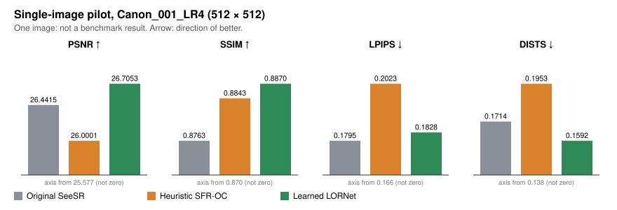
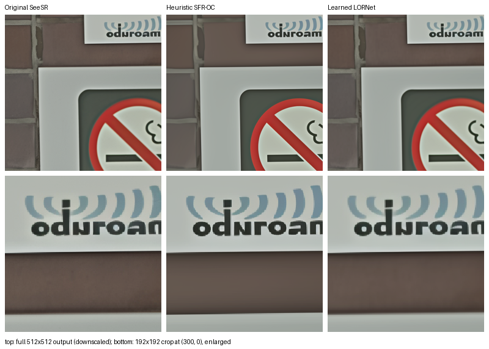

# Results

Two kinds of evidence exist in this project, and they are kept apart:

* **Observed pilot results** (this page): single-image GPU runs of original SeeSR, heuristic SFR-OC and learned
  LORNet SFR-OC on a RealSR test crop, with every artifact saved in [`assets/pilots/canon_001/`](../assets/pilots/canon_001/).
* **Controlled ablation results**: none yet. The ablation (`experiments/configs/v2_ablation.yaml`: same code,
  environment and V1 setting for every variant, one change at a time, RealSR + DRealSR, three seeds) is configured
  and planned; see [`experiments.md`](experiments.md).

## LORNet training (`lornet_v1`)

| | |
|---|---|
| Data | RealSR V3 Canon + Nikon `Train/4`: 400 pairs, 368 training / 32 validation images |
| Latent cache | 1,088 training / 101 validation crops; τ = 0.32633 |
| Run | Colab Tesla T4, 12 epochs (≈ 14 s each), early stopping at epoch 11 |
| Selected checkpoint | epoch 3, validation loss **0.111512** |
| Trainable parameters | 33,049 (SeeSR frozen) |

Per-epoch log: [`lornet_v1_train_log.jsonl`](../assets/training/lornet_v1_train_log.jsonl); summary and software
versions: [`lornet_v1_summary.json`](../assets/training/lornet_v1_summary.json), both from the `train_lornet.py` output
saved in the Colab notebook at `19ac39e`. The learned pilot loaded this checkpoint (SHA-256 `bdeb3a0f…34b41`, τ
0.3263322644979552). Validation loss reached its minimum at epoch 3 and stayed within 0.112–0.121 afterwards.

## Pilot: Canon_001_LR4 (RealSR test crop, 128 → 512)

| Metric | Original SeeSR | Heuristic SFR-OC | Learned LORNet |
|---|---:|---:|---:|
| PSNR ↑ | 26.4415 | 26.0001 | 26.7053 |
| SSIM ↑ | 0.8763 | 0.8843 | 0.8870 |
| LPIPS ↓ | 0.1795 | 0.2023 | 0.1828 |
| DISTS ↓ | 0.1714 | 0.1953 | 0.1592 |

**Findings.**

* Learned LORNet SFR-OC gave the best fidelity and structure scores: **+0.26 dB PSNR** over original SeeSR, the best
  SSIM (0.8870) and the best DISTS (0.1592, −0.012), at near-equal LPIPS (+0.003).
* Learned reliability outperformed the heuristic map on all four metrics (+0.71 dB PSNR, −0.036 DISTS).
* Heuristic SFR-OC improved SSIM (+0.008) but lost on PSNR, LPIPS and DISTS.
* Both reliability pathways run end to end on a Tesla T4 in fp16; the SFR-OC correction costs ≈ 13–20 ms for all 30
  steps.

**Scope.** One image and one seed. The three runs also differ in more than the reliability source (V1, semantic
map, reference latent, software stack; table below), so the differences are observations, not attributions; the
controlled ablation is what isolates LORNet's contribution.

### Run provenance (from `run_metadata.json`)

| | Original SeeSR | Heuristic SFR-OC | Learned LORNet |
|---|---|---|---|
| Run | `realsr_single_image_pilot` | `realsr_heuristic_pilot` | `realsr_lornet_learned_pilot` |
| Code | `77e664f` | `19ac39e` + runtime fixes (2.1.1) | `77e664f` |
| Method | upstream | V1 (A + B + SSR) + SFR-OC, heuristic O ⊕ SSR map | SFR-OC, LORNet O ⊕ constant S = 0.5 (V1 off) |
| SFR-OC | – | strength 1.0, mean γ 0.48, low band | same |
| Reference latent | – | extra VAE encode | pipeline's LR encode |
| Mean W / O / S | – | 0.592 / 0.574 / 0.391 | 0.530 / 0.561 / 0.5 |
| Attention, software | xformers 0.0.20, torch 2.0.1 | PyTorch SDPA, torch 2.0.1 | PyTorch SDPA, torch 2.14.1, NumPy 2.2 |
| Diffusion time / peak VRAM | 20.76 s / 6863 MB | 14.83 s / 5765 MB | 15.54 s / 6864 MB |
| SFR-OC analysis / correction | – | 546 ms / ≈ 20 ms | 1959 ms (first call) / 13 ms |

Shared: same LR file (`lr_dir_fingerprint` `aecdd6dd…`), DDPM 30 steps (t = 958 … 1), CFG 5.5, seed 42, fp16,
LR-embedded start, AdaIN, Tesla T4; evaluated with `evaluate.py --paired` (pyiqa 0.1.10; PSNR/SSIM on Y, no border
crop) against the same GT. `python experiments/tools/pilot_report.py check` re-verifies both tables on this page and
in the README against the CSVs. Timing notes: diffusion time differs mainly by attention backend; the heuristic
run recorded 735 ms correction because its timer included the 715 ms reference encode (fixed in 2.1.1, regression
test `test_correction_time_excludes_the_reference_encode`).

### Test-set provenance of the pilot image

Checked on 2026-11-20 with [`check_pilot_holdout.py`](../experiments/tools/check_pilot_holdout.py) (Colab):

| Check | Result |
|---|---|
| Pilot LR = StableSR `RealSRVal_crop128/test_LR` file | byte-identical, SHA-256 `b1b946a84ed9117982021c74636d15edfa4c8516ef506953b9920feaf4a609a4` |
| Pilot GT = StableSR `RealSRVal_crop128/test_HR` file | byte-identical, SHA-256 `93aa7efa55fa00d2162900c9c4609313558aec44a61901e90e3fe3b2b12180a4` |
| Input folder = the one all three pilot runs read | `lr_dir_fingerprint` recomputed: `aecdd6dd…1f775e08`, match |
| Byte duplicates in LORNet's training folders | **800 files** (Canon + Nikon `Train/4`, HR and LR) hashed: none |
| Content overlap (crop searched in training LR images, NCC) | **42 LR images** searched, max NCC 0.363 (threshold 0.95): none found — **partial**: the folders hold ≈ 400 LR images |

The pilot image is therefore confirmed as the StableSR RealSR test crop and has no byte-identical copy in the
training data. The content-overlap search covered 42 of the ≈ 400 training LR images, so it is not a complete
verification; the tool (since fixed to select LR files case-insensitively and to require full coverage) completes
it in one further run. The checkpoint was trained on the RealSR V3 `Train` split only.

### Debugging history

Six heuristic attempts failed before the successful run (kept on Drive as `__replaced_*`): an SSR device mismatch
(fix 1), a CPU Gaussian kernel on a GPU grid (fix 2), NumPy conversion of a GPU grid (fix 3), `torch.quantile` on
fp16 (fix 4) and twice the `reference_cfg_identical` check (fix 5). All five fixes are in 2.1.1 with regression
tests. The heuristic run's metadata says `reference: auto`; its code performed the extra encode, now the explicit
default (`extra_encode`); the learned pilot's reference corresponds to `reference: pipeline`.

## Next

Dataset-level RealSR (100) and DRealSR (93) evaluation of the V2.1 ablation with paired statistics over three
seeds, strength screening and map validity — in that order ([`experiments.md`](experiments.md)).
